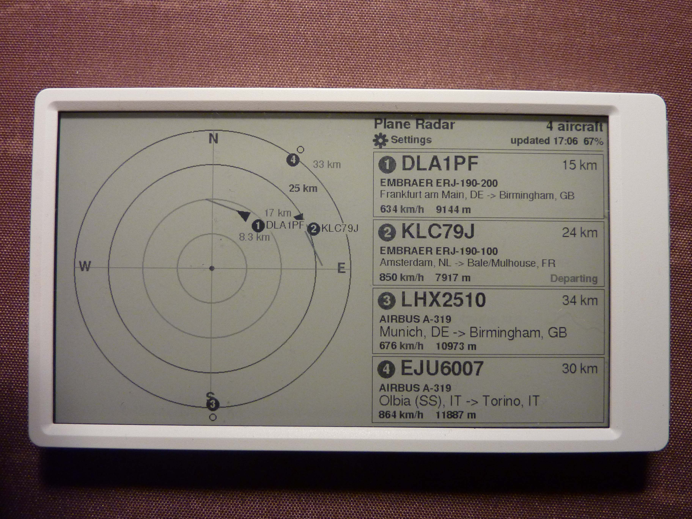

# M5Paper-PlaneRadar

Live nearby-aircraft radar for the **M5Paper** (960×540 e-ink, ESP32).
It's a port of the Plane Radar widget from
[info-orbs PR #329](https://github.com/brettdottech/info-orbs/pull/329), which
was inspired by [ESP32-Plane-Radar](https://github.com/MatixYo/ESP32-Plane-Radar).

- ADS-B data: [adsb.fi opendata API](https://opendata.adsb.fi/), no API key needed
- Routes: [adsbdb.com](https://api.adsbdb.com/)

## Using it
- **Tap empty radar** (or press the side wheel) to cycle the range: 5 / 10 / 15 / 25 mi, or 5 / 10 / 15 / 25 / 40 / 50 km with metric units.
  The choice is saved.
- **Tap a plane** to pin it to detail card 1; tap it again to unpin.
- **Tap the header** (the gear and "Settings" under the title) to open the **settings** screen. It shows a QR
  code for the settings page on your home network (`http://planeradar.local/`), where
  you set WiFi, location, units, time zone and update intervals from a phone.
  Saving restarts the radar.
- **Start setup WiFi** (on the settings screen) is for a new network: the radar runs
  its own WiFi `PlaneRadar-XXXX` and shows two QR codes, one to join it and one to open
  the settings page. Setup also starts by itself when no WiFi is saved, or after
  three failed connection attempts; tap the "WiFi failed" screen to start it sooner.
- **Hold the side wheel** to switch to **battery mode**: the device updates every
  5 minutes (`RADAR_BATTERY_INTERVAL_SEC`) and powers off in between.
  To go back to live mode, hold the wheel in while restarting (power or reset button).

### Battery life (estimate)
Each battery-mode wake is on for about 12-18 s (WiFi, aircraft fetch, four route
lookups, e-ink refresh). At a 5-minute interval that's roughly 6 mAh per hour,
so about a week on the 1150 mAh battery. Live mode keeps WiFi on and lasts only
a few hours on battery; use USB power for it.

## Build
1. Install [PlatformIO](https://platformio.org/).
2. Optional: copy `src/config.h.template` to `src/config.h` and fill in WiFi and
   coordinates. These are only first-boot defaults; settings saved on the device win.
   Without `config.h` the radar starts in setup mode.
3. Run `pio run -t upload`, then `pio device monitor`.

## Note
This project was used to learn more about how to automate Claude Code
generating code, compiling, debugging, uploading the code to the target, and
testing it.

## License
AGPL-3.0, matching info-orbs, since parts of this project are derived from its code. See `LICENSE`.
